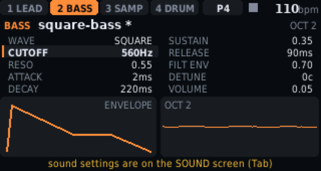
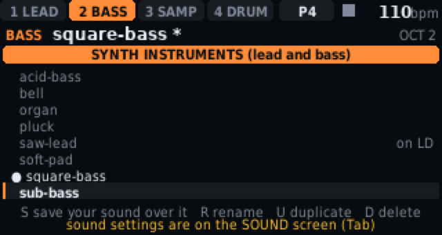
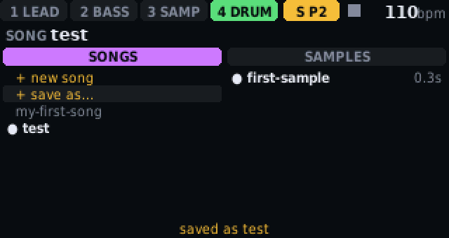
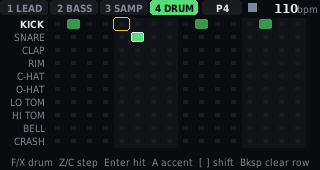

# ZSynth

A pocket groovebox for the M5Stack **Cardputer Zero**: two synths, a mic
sampler and a drum kit, eight patterns per song (1–32 steps, any time
signature), a song chain, and
libraries of songs, samples and instruments.

 
 

 

## Features

- **Four tracks**: Lead synth, Bass synth, Sampler, Drums. Each track plays
  an instrument and has its own pattern.
- **Instruments**: design a track's sound on the Sound screen, and keep the
  ones you like in the instrument library. It starts with a set of synths
  (saw-lead, night-lead, pluck, soft-pad, bell, organ, square-bass,
  disco-bass, acid-bass, sub-bass), sampler instruments built on the starter
  samples (fm-piano, harpsichord, marimba, kalimba, glockenspiel, tenor-sax,
  sax-stab, harmonica) and three drum kits. Browsing the library plays each one
  so you can hear it, even while your pattern loops. A song keeps its own
  copy of each instrument, so changing the library never changes old songs.
- **Synths**: sine, triangle, saw and square oscillators (band-limited), a
  detuned second oscillator, an ADSR envelope, and a resonant low-pass filter
  with envelope modulation. Polyphonic.
- **Sampler**: records up to 5 s from the built-in mic, trims the silence and
  normalises it, then plays it across the keyboard. Choose one-shot or gate
  mode. You can also load your own 16-bit WAV files.
- **Drums**: ten synthesised sounds: kick, snare, clap, rim, closed and open
  hats, low and high toms, cowbell and crash.
- **Sequencer**: a loop of 16th-note steps. Arm recording and play along;
  notes snap to 16ths, note lengths are kept, and a metronome clicks on each
  beat while you record.
- **Pattern length and time signature**: each pattern has its own length,
  from 1 to 32 steps, and a beat (4 steps for x/4, 2 or 6 for x/8). Presets
  for 4/4, 3/4, 5/4, 7/4, 2/4, 6/8, 7/8, 9/8 and 12/8. In song mode each
  pattern plays its own length, so a 7/8 bar can follow a 4/4 one.
- **Step editing**: the Edit screen turns the drum track into a classic drum
  machine grid (10 drums × the pattern's steps, with accents). On the other tracks it
  becomes a piano roll: play notes or chords and they're written into the
  step under the cursor. You can also set note lengths, enter rests, delete
  steps and shift a whole track left or right.
- **Pattern banks**: 8 patterns per song. Switching while the loop plays
  waits until the end of the bar. You can copy and paste whole patterns.
- **Song mode**: chain patterns (for example 1 1 2 3) and play them in order.
- **Songs**: save, save as, new, open and delete named songs. A song keeps its
  patterns, chain, tempo, sound settings and which sample it uses.
- **Sample library**: every mic recording is saved as its own WAV. Each
  sample has a menu to play it, put it in the sampler, rename it (songs that
  use it follow the new name), duplicate it or delete it.
- **Starter samples**: 18 sounds from the CC0 [Versilian Community Sample
  Library](https://github.com/sgossner/VCSL): FM piano, clavi, harpsichord,
  glockenspiel, marimba, balafon, harmonica, ocarina, tenor sax and a sax
  stab, folk harp, kalimba and mbira (all retuned to play in tune), plus wine
  glass, hand bell, gong, didgeridoo and a zither glissando for effects. See
  [samples/CREDITS.md](samples/CREDITS.md).
- **Demo song**: *night-shift*, an 87-second dance-punk track at 118 BPM
  (eight patterns in a 43-bar chain). Open it on the Files screen and press
  `Space`: song mode is already on.
- **Live scope**, step grid and envelope picture on the 320×170 screen.
- The open song is saved automatically when you quit or switch songs.

## Screens

`Tab` cycles through five screens:

- **Main**: play and record, with the scope, each track's instrument, and the
  current pattern's step grid.
- **Edit**: edit the current track of the current pattern step by step: a
  drum grid for the drums, a piano roll for the others.
- **Sound**: the instrument designer for the current track: every setting,
  the envelope, and the scope. Play notes to hear your changes. `Enter` opens
  the instrument library.
- **Song**: the eight pattern slots, with a preview of each, and the chain.
- **Files**: songs on the left, samples on the right.

## Keys

`Fn` + a key uses the Cardputer's function layer: `Fn`+number row gives
F1–F10, `Fn`+`F` `Z` `X` `C` gives the arrow keys, and `Fn`+`H` gives Help.

| Key | Action |
| --- | --- |
| `Z X C V B N M` + `S D G H J` | notes, lower octave (white + black keys) |
| `Q W E R T Y U I O P` + `2 3 5 6 7 9 0` | notes, upper octave |
| `Space` | play / stop the loop |
| `Enter` | record on/off: play while it loops |
| `Backspace` | undo the last recorded note |
| `Tab` | next screen: Main → Edit → Song → Files |
| `Fn` + `H` | help |
| `Fn` + `1`–`8` | choose a pattern (while playing, it switches at the end of the loop) |
| `Fn` + `0` | song mode on/off |
| `Esc` | back to Main / quit (the song is saved) |
| `Ctrl` + `1`–`4` | choose a track: lead, bass, sample, drums |
| `Ctrl` + `Q` / `W` | on the Sound screen: choose a setting |
| `Ctrl` + `A` / `S` | on the Sound screen: change it (hold to repeat) |
| `Ctrl` + `Z` / `X` | octave down / up |
| `Ctrl` + `B` / `N` | tempo down / up |
| `Ctrl` + `C` / `V` | copy the current pattern / paste it into the current pattern |
| `Ctrl` + `R` | start / stop recording a sample (saved to the library) |
| `Ctrl` + `L` | load the next sample from the library |
| `Ctrl` + `Backspace` | clear this track in the current pattern (on the Song screen: the whole pattern, after you press it twice) |

`Alt` works the same as `Ctrl`. On the drum track, each key plays one drum;
the key map is shown on screen.

**Edit screen, drums:** `F`/`X` pick a drum and `Z`/`C` pick a step (the
arrows printed on those keys; `Fn` isn't needed here). `Enter` adds or
removes a hit, `A` turns an accent on or off, and `Backspace` pressed twice
clears that drum's row.

**Edit screen, other tracks:** play a note key to write that note into the
step under the cursor. The cursor then moves on by the note length. Hold
several keys to write a chord, and play the same note on a step again to
remove it. `Fn`+`Z`/`C` move the cursor, `Enter` skips a step (a rest),
`Backspace` clears the step, and `-` / `=` (or `+`) make notes shorter or
longer (also changing the notes already on the step). `Ctrl`+`Z`/`X` change
the octave, as on the main screen.

**Edit screen, both:** `[` / `]` shift the whole track one step left or
right. The symbol keys (`[ ] - = +`) are typed the usual way on the
Cardputer, through its symbol layer. `Space` plays and stops, so you can edit while the loop plays; the
playhead shows on the grid. `Ctrl`+`1`–`4` switches track and `Fn`+`1`–`8`
switches pattern, as everywhere.

**Sound screen:** `Fn`+`F`/`X` pick a setting and `Fn`+`Z`/`C` change it
(hold to repeat; `Ctrl`+`Q`/`W` and `Ctrl`+`A`/`S` work too). The note keys
play the track so you can hear it. A `*` after the instrument's name means
you've changed it since it came from the library. `Enter` opens the
instrument library for this track (lead and bass share the synth ones):

| Key | Action |
| --- | --- |
| `F` / `X` | move through the list. Each instrument is put on the track and played, so you hear it (press `Space` first to hear it in your loop) |
| `P` | play the selected one again |
| `Enter` | keep the selected instrument. On *+ save this sound as…*: save your sound as a new instrument |
| `S` | save your sound over the selected instrument (press twice) |
| `R` / `U` / `D` | rename / duplicate / delete (press twice) the selected instrument |
| `Esc` | close and put back the sound you had |

The first time the new version runs, it also saves the custom sounds in your
existing songs as instruments, named *song*-*track*.

**Song screen:** `1`–`8` insert a pattern into the chain at the cursor,
`Backspace` removes the one before the cursor, `Z`/`C` move the cursor, and
`Enter` turns song mode on or off. For the current pattern (`Fn`+`1`–`8`),
`-` / `=` (or `+`) make it a step shorter or longer (hold to repeat), and `M`
steps through the time signatures. The screen shows the current pattern's
meter and length, and tags each pattern that isn't 4/4. Shortening a pattern
keeps the notes past the new end: they come back when you lengthen it again.
Copying a pattern (`Ctrl`+`C`/`V`) copies its length too.

On the Edit screen, a pattern longer than 16 steps is shown 16 steps at a
time; moving the cursor past the edge turns the page.

**Files screen:** `F`/`X` move up and down, `Z`/`C` switch between Songs and
Samples, `Enter` opens a song (or runs *new song* / *save as…*, which ask for
a name), `S` saves the open song, and `Backspace`/`Del` pressed twice deletes
the selected file. In the Samples column, `P` plays the selected sample as
recorded (press again to stop) and `Enter` opens its menu:


| Key | Action |
| --- | --- |
| `P` | play / stop, without loading it |
| `L` | use it in the sampler track |
| `R` | rename it: every song that uses it is updated |
| `U` | duplicate it (as *name*-copy) |
| `D` | delete it (press twice) |

`F`/`X` and `Enter` work too, and `Esc` closes the menu. The menu shows the
sample's length and how many songs use it.

## How it works

- `engine.c` is the real-time audio engine. It handles synthesis, the
  sequencer clock, sample playback and mic capture, and talks to PipeWire
  through the PulseAudio API. The ALSA default device on the stock image
  points at the HDMI port, so it doesn't use ALSA directly. It takes text
  commands on stdin and publishes its state (playhead, scope, pattern grid)
  in `/dev/shm/zsynth.state`.
- `zsynth.py` is the front end. It reads the keyboard from evdev, draws with
  pygame straight to the LCD framebuffer (`/dev/fb0`, RGB565), and drives the
  engine over a pipe. It is launched from the stock APPLaunch launcher like
  the built-in apps.

Data lives in `~/.local/share/zsynth/`:

- `songs/<name>.zsong` is a plain-text song file. It holds the sample name,
  the sound settings, the tempo, the chain, each pattern's length and beat
  as `len pattern steps beat` (left out for 16-step 4/4 patterns), and every
  note as `ev pattern track step note velocity length`.
- `instruments/<synth|sampler|drums>/<name>.zinst` is the instrument
  library: plain text, one `param index value` line per setting (and the
  sample's name, for sampler instruments).
- `samples/*.wav` is the sample library. Mic recordings are named
  `rec-YYYYMMDD-HHMMSS.wav`. You can copy in your own 16-bit WAVs at any
  sample rate, mono or stereo.
- `state.json` remembers which song was open last.

A single-pattern song from an earlier version is moved into
`songs/my-first-song.zsong` the first time you open this version.

## Install

You need a Cardputer Zero on the official 64-bit Debian 13 image, reachable
over SSH with passwordless `sudo`. From this folder on your computer, run:

```sh
./install.sh user@cardputer-ip
```

This copies the sources, installs `libpulse-dev` if needed, compiles the
engine on the device, installs it to `/opt/zsynth`, and adds **ZSynth** to the
launcher. The first time ZSynth starts, it adds the starter samples, the demo
song and the starter instruments to your library (once each, so ones you
delete stay deleted).

### Debian package (for the CardputerZero AppStore)

```sh
./package.sh user@cardputer-ip
```

builds `dist/zsynth_<version>_arm64.deb`. The engine is compiled on the
Cardputer, so it's built for its arm64 processor. The package's name,
version, summary, author and license come from `app-builder.json`, which also
holds the store listing (icon and screenshots in `store/`). Install it with
`sudo apt install ./zsynth_<version>_arm64.deb`, or publish it with
[`czdev publish`](https://github.com/cardputerzero/AppBuilder) or the
developer portal at [dev.cardputer.cc](https://dev.cardputer.cc).

`test_ui.py` runs the app headless with simulated key presses, checks
pattern banks, the drum grid, step entry, the chain, song mode and
saving/opening songs, and saves
screenshots. Run it on the device with `python3 test_ui.py /tmp/zs`.

## Requirements

The stock image already has Python 3 with pygame and numpy. The engine
needs `libpulse-dev` to build, and the install script adds it.
