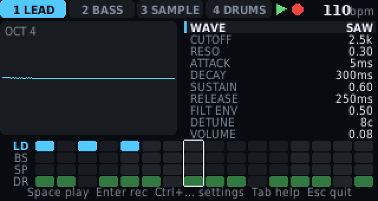

# ZSynth

A pocket groovebox for the M5Stack **Cardputer Zero**: two synths, a mic
sampler and a drum kit, with a 16-step sequencer that records what you play.

 

## Features

- **Four tracks**: Lead synth, Bass synth, Sampler, Drums. Each track has its
  own sound settings and pattern.
- **Synths**: sine, triangle, saw and square oscillators (band-limited), a
  detuned second oscillator, an ADSR envelope, and a resonant low-pass filter
  with envelope modulation. Polyphonic.
- **Sampler**: records up to 5 s from the built-in mic, trims the silence and
  normalises it, then plays it across the keyboard. Choose one-shot or gate
  mode. You can also load your own 16-bit WAV files.
- **Drums**: ten synthesised sounds: kick, snare, clap, rim, closed and open
  hats, low and high toms, cowbell and crash.
- **Sequencer**: a 16-step loop. Arm recording and play along; notes snap to
  16ths, note lengths are kept, and a metronome clicks while you record.
- **Live scope**, step grid and settings on the 320×170 screen.
- Everything is saved when you quit: the song, the sounds and the sample.

## Keys

| Key | Action |
| --- | --- |
| `Z X C V B N M` + `S D G H J` | notes, lower octave (white + black keys) |
| `Q W E R T Y U I O P` + `2 3 5 6 7 9 0` | notes, upper octave |
| `Space` | play / stop the loop |
| `Enter` | record on/off: play while it loops |
| `Backspace` | undo the last recorded note |
| `Tab` | help screen |
| `Esc` | quit (everything is saved) |
| `Ctrl` + `1`–`4` | choose a track: lead, bass, sample, drums |
| `Ctrl` + `Q` / `W` | choose a setting |
| `Ctrl` + `A` / `S` | change it (hold to repeat) |
| `Ctrl` + `Z` / `X` | octave down / up |
| `Ctrl` + `B` / `N` | tempo down / up |
| `Ctrl` + `R` | start / stop recording a sample from the mic |
| `Ctrl` + `L` | load the next WAV from `~/.local/share/zsynth/samples/` |
| `Ctrl` + `Backspace` | clear this track's pattern |

`Alt` works the same as `Ctrl`. On the drum track, each key plays one drum;
the key map is shown on screen.

## How it works

- `engine.c` is the real-time audio engine. It handles synthesis, the
  sequencer clock, sample playback and mic capture, and talks to PipeWire
  through the PulseAudio API. The ALSA default device on the stock image
  points at the HDMI port, so it doesn't use ALSA directly. It takes text
  commands on stdin and publishes its state (playhead, scope, pattern grid)
  in `/dev/shm/zsynth.state`.
- `zsynth.py` is the front end. It reads the keyboard from evdev, draws with
  pygame straight to the LCD framebuffer (`/dev/fb0`, RGB565), and drives the
  engine over a pipe. It is launched from the stock APPLaunch launcher like
  the built-in apps.

Data lives in `~/.local/share/zsynth/`: `pattern.txt`, `state.json`,
`sample.wav`, and a `samples/` folder for your own WAVs.

## Install

You need a Cardputer Zero on the official 64-bit Debian 13 image, reachable
over SSH with passwordless `sudo`. From this folder on your computer, run:

```sh
./install.sh user@cardputer-ip
```

This copies the sources, installs `libpulse-dev` if needed, compiles the
engine on the device, installs it to `/opt/zsynth`, and adds **ZSynth** to the
launcher. Then restart the launcher.

`test_ui.py` runs the app headless with simulated key presses and saves
screenshots, which is handy for checking changes over SSH.

## Requirements

The stock image already has Python 3 with pygame and numpy. The engine
needs `libpulse-dev` to build, and the install script adds it.
